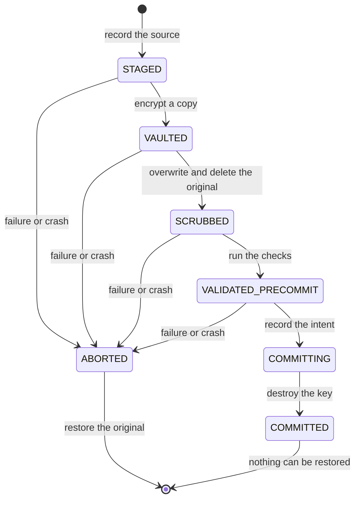

# jverifydestroy (jvd)

**jvd destroys a file, proves the destruction, and lets anyone check the proof later.**

It deletes a file with a crypto-shred. The data becomes unreadable because the key is
destroyed. Then jvd writes a signed record of what it did. Then it gives you an offline
verifier that checks the record and reports if anyone changed it.

```bash
./bin/jvd destroy-file secret.txt --work work --log log
```

```
key=3a3682723dfc9c5d64abcfc282f65ec0ff501a048428cdc32ac6660545c06cf8
keep this key: a transaction that has to be recovered needs it again.
state=COMMITTED
artifact=work/artifact.enc
postCommitDecryptFailed=true
```

Keep that key. It is not written to disk anywhere, because a key stored beside the
ciphertext it protects would undo the whole point of destroying it.

## What it actually does

jvd runs the NIST SP 800-88 Rev.2 sanitization workflow and then *measures* the result
instead of asserting it. Most erasure tools answer *what* was destroyed and *how*. They
answer *whether it worked* weakly, and *whether the evidence is honest* hardly at all. The
tool grades its own homework.

jvd automates verification so the validation decision does not become a rubber stamp. It
follows Rev.2: **verification** inspects the outcome of the sanitization operation.
**validation** is the separate, risk-based **decision** that reviews the verification
results and accepts, rejects, or escalates. jvd records these as two separate fields and
never merges them.

## The scope, stated exactly

Every erasure tool has a boundary. Here it is, precisely, so you can decide whether it
fits your situation.

| What jvd destroys | What jvd cannot reach | Who closes the rest |
|---|---|---|
| The file's bytes, verified by re-reading them | Copies the drive made **before** jvd ran: backups, snapshots, swap, replication | Your backup and retention policy |
| The key that opens the encrypted container | Copies the drive keeps **for itself**: SSD flash translation layers, bad-block pools, controller-held copies | Drive-level sanitize (NVMe sanitize, Block Erase), or your storage provider's purge API |
| The secret's place in the JVM heap | A compromised JVM, OS, or kernel | Trust in your platform |
| The evidence record's integrity | An operator who never runs the verifier, or a witness that colludes with the operator | Run `jvd-verify`; use a witness you control |

**The honest summary:** jvd proves the software-level destruction happened and that the
record of it is genuine. It does not claim your SSD's flash was sanitized, because no
user-space program can know that. Rev.2 calls a tool's scope *logical level* and the
device-level work *physical media sanitization*. jvd is the first; the table names the
tool that does the second.

This is a boundary, not a defect. The alternative, claiming more than the tool can see,
is what makes erasure evidence worthless in an audit.

## How it works

```
   pick a file
        │
        ▼
   ┌─────────────┐   encrypt a copy with a fresh per-file key
   │  1. VAULT   │──────────────────────────────┐
   └──────┬──────┘                              │
          │                                     ▼
   ┌──────┴──────┐   overwrite the original    ┌────────────┐
   │  2. SCRUB   │   with zeros, then delete  │ ciphertext  │
   └──────┬──────┘                             │ (kept)     │
          │                                     └─────┬──────┘
   ┌──────┴───────┐   checks that it works              │
   │ 3. VALIDATE  │───────────────┐                     │
   └──────┬───────┘               │                     │
          │                       ▼                     ▼
   ┌──────┴───────┐        ┌────────────┐        ┌────────────┐
   │ 4.  COMMIT   │        │  ABORTED   │        │ destroy the│
   │ destroy key  │        │ restore the│        │  key       │
   └──────┬───────┘        │  original  │        └────────────┘
          │                └────────────┘
          ▼
   signed record + Merkle log + witness co-signature
          │
          ▼
   jvd-verify  →  OK  |  TAMPER DETECTED
```

The transaction state machine is the core of the tool. Every state change goes to a
write-ahead journal. The journal decides what a crash recovery does.



`COMMITTING` exists for a reason. Destroying the key cannot be undone, so the journal
records the intent to do it **before** it happens. If the process dies in that window,
recovery looks at the filesystem rather than the journal: the key file gone means the
destruction happened and stands; the key file still there means it did not, and the
original is restored. Neither case reports a destroyed file as never destroyed.

**Four decisions carry the tool.**

1. **The canary has a positive control and a negative control on every run.** The verifier
   runs three child JVMs: one target, one that must be found, and one that must not be
   found. A run with a failed control is `INVALID`. `INVALID` caps the assurance level at
   `A0`. "Found nothing" without a control proves nothing. This is the difference between
   the tool grading its own homework and the tool proving its homework.
2. **The evidence log uses RFC 6962 hashing, not RFC 9162.** C2SP checkpoints hash over the
   RFC 6962 tree. RFC 9162 is the Certificate Transparency v2 framing, and it is
   Experimental. The log also refuses a witness co-signature when the witness key is the
   log key, because such a witness attests to nothing.
3. **A rollback writes the ABORTED event before it restores the file.** If the restore ran
   first, a rollback could hide a failed destruction.
4. **The tool writes one overwrite pass, not seven.** NIST SP 800-88 Rev.2 and IEEE 2883
   treat extra passes as folklore on modern media. The measured data agrees: one pass and
   seven passes give the same result. One verified pass beats seven unverified ones.

## See it work

```
$ ./bin/jvd destroy-file secret.txt --work work --log log
key=3a3682723dfc9c5d64abcfc282f65ec0ff501a048428cdc32ac6660545c06cf8
keep this key: a transaction that has to be recovered needs it again.
state=COMMITTED
artifact=/home/you/work/artifact.enc
postCommitDecryptFailed=true
assurance=A0 (A0 here: no canary controls run by this command - see README)
record=/home/you/work/evidence-record.json
logSize=1
```

```
$ ./bin/jvd verify --log log
OK: log verified (size=1, root matches checkpoint, signatures valid, inclusion proofs valid)
```

Change one byte of a stored record, and the verifier says so:

```
$ ./bin/jvd verify --log log
TAMPER DETECTED: checkpoint root does not match recomputed log root (record edited)
TAMPER DETECTED: the log does not match its checkpoint or its signatures
```

## Run it

You need **JDK 25** and a Linux machine. The memory verifier reads `/proc/<pid>/mem`, so
it does not work on macOS or Windows. The tool reports `NOT_CHECKABLE` there. It never
guesses.

### The desktop app

The app hides the machinery. The user picks one file, presses one button, and watches the
work happen in plain language.


*The desktop app, after a file was destroyed. The real window, running the real
transaction.*


*The same app after the user pressed "Check my history". The record verifies against its
signatures and the witness co-signature.*

```
$ ./bin/jvd-desktop
```

The window shows each stage as it really happens, because the stages come from the
transaction itself:

```
1. Checking your file — We looked at your file and started the job.
2. Making a protected copy — We made an encrypted copy of your file. Without the key it is just noise.
3. Destroying the original — The original file was overwritten with zeros and then deleted.
4. Final check before we make it permanent — Everything is in order. Next we destroy the key that opens the copy.
5. Making it permanent — We destroyed the key that could open your file's copy. Your data can no longer be read.
6. Testing that it really cannot be read — We tried to read the copy we kept. The copy could not be read, because the key that opened it is gone.
7. Writing the signed record — We wrote a signed record of what happened, so you can show it to anyone.
8. Adding it to the history — We added the record to your history of destructions, countersigned by a second, independent key.
9. Done — Your file has been destroyed and we verified it.
```

Then the window shows the proof in plain words, and states the limit next to the success
message:

```
Record ID                 ea74b5a4-5e93-48ea-8772-f8779a543f98
What was destroyed        212a95fa63e786353ca2ac8227a0bbaa45d3c5afd52b1966f5791e8c2128df7f
How it was destroyed      Destroyed by making the key unreadable (the strongest method this app has)
Did the check pass?       Yes - the app confirmed the data can no longer be read
Signed off by a person    Waiting for a person to review and accept this record
Signature                 Present and valid - nobody has changed this record since it was signed
What we could not check   Copies the drive keeps for itself cannot be checked from software.
```

The app needs a display. Without one it says so and points at the command line tool
instead of printing a stack trace.

### The command line

```bash
# Build the runnable jars (about 40 seconds)
./mvnw -B package

# Destroy a file and write the signed record
./bin/jvd destroy-file secret.txt --kek-hex <64-hex-chars> --work work --log log

# Check the record later, with no network and no trust in the operator
./bin/jvd-verify --log log --checkpoint log/checkpoint.txt --pubkey <b64>

# Verify that a secret is really gone from process memory
./bin/jvd verify-memory --gc ZGC
```

The `bin/jvd` script sets `--enable-native-access=ALL-UNNAMED` for you. The FFM downcalls
in the memory module need this flag. Without it the tool still works, but it reports
degraded hardening.

## What the measurements say

Full data and the method are in `docs/RESULTS.md`. The CSVs are in `experiments/results/`.

**Memory.** After one promotion GC, wiping the live array leaves a findable stale copy in
199 of 200 trials under G1, and in 197 of 200 trials under ZGC. Seven overwrite passes
change nothing. Shenandoah leaves only 2 of 200.

**Files.** Deleting a file leaves all 200 of 200 canary files readable in the raw ext4
image. A single overwrite reads back clean at the logical level in 200 of 200 trials.

**Tamper detection.** The offline verifier detects an edited record, a deleted record, a
backdated record, and a forked log in 50 of 50 trials for each type.

| Result | Count |
|---|---|
| Heap wipe, G1, stale copy found | 199 / 200 |
| Heap wipe, ZGC, stale copy found | 197 / 200 |
| Heap wipe, Shenandoah, stale copy found | 2 / 200 |
| File overwrite, clean read-back | 200 / 200 |
| File delete only, contents still in image | 200 / 200 |
| Tamper detection, per tamper type | 50 / 50 |

## Modules

| Module | What it does | Tests |
|---|---|---|
| `destroy-memory` | `SecretBuffer`: off-heap storage via FFM, page-aligned, fills with zeros before close, attempts `mlock` and `MADV_DONTDUMP` and reports the result | 4 |
| `destroy-file` | Single-pass overwrite with fsync and delete, and per-file crypto-shred with AES-256-GCM | 4 |
| `txn` | The transaction state machine and the write-ahead journal, with crash recovery | 9 |
| `verify` | The canary verifier: parent process, child processes, positive and negative controls | 4 |
| `evidence` | The signed evidence record, and the `verification` and `validation` split | 4 |
| `log` | The RFC 6962 Merkle log, signed checkpoints, witness co-signature, proofs | 6 |
| `cli` | The `jvd` command line tool: destroy, verify, recover, memory self-test | 2 |
| `verifier-cli` | The `jvd-verify` offline verifier | 6 |
| `gui` | The desktop app: one file, one button, plain language | 14 |

The build runs 53 tests. `./mvnw -B verify` runs them.

## Assurance levels

- **A0** — deletion only, or any run whose controls failed, or a transaction that is still
  before COMMIT.
- **A1** — overwrite or heap wipe, plus a canary that is `NOT_FOUND` in all checkable
  locations, plus valid controls.
- **A2** — a crypto-shred that reached COMMIT, plus a post-commit decrypt attempt that
  fails, plus valid controls.
- **A3** — A2, plus evidence in a witness co-signed log, plus independent re-validation by
  a separate process.

Every level carries "physical media NOT verified".

## Prior work and novelty

Crypto-shredding, hash-chained logs, overwriting, and Merkle transparency logs are all
prior art. This project does not claim them. The audit in `docs/RESEARCH_AUDIT.md` checks
26 claims against primary sources: 13 CONFIRMED, 9 PARTLY, 4 UNVERIFIABLE, 0 REFUTED.

What this project defends as its own: control-validated verification of Java destruction
with a measured false-assurance rate; the empirical matrix of secret patterns, collectors,
and JIT levels on JDK 25; the coupling of rollback to failed validation with the ABORTED
event witnessed before the restore; and a witness co-signed log for destruction evidence
with an offline verifier. See `docs/RELATED_WORK.md`.

## Build and test from source

```bash
./mvnw -B verify          # compile and run all 53 tests
./mvnw -B package         # build the runnable jars
scripts/run_experiments.sh   # regenerate the experiment data (about 15 minutes)
```

The scripts in `experiments/` and `spikes/` need `python3`. They write their output to
`experiments/results/`. The library and the command line tools make no network calls.

## Licence and credits

MIT. See `LICENSE`.

The research in `docs/RESEARCH_AUDIT.md` cites primary sources for every claim. The NIST
SP 800-88 Rev.2 and IEEE 2883 documents set the scope. Prior art and its licensing are
listed in `docs/RELATED_WORK.md`.

If this project helped you, a star helps the next person find it.
