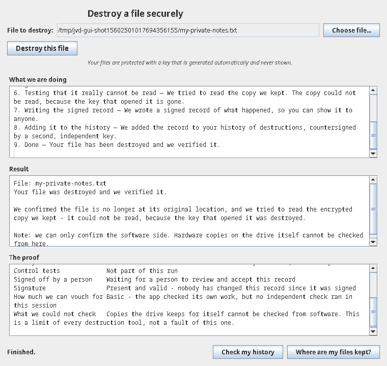
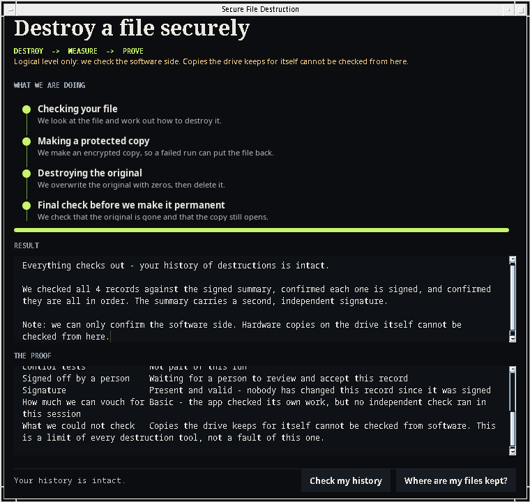

# Vestige

**Vestige destroys a file, proves the destruction, and gives anyone a verifier to check the proof later.**

It deletes a file with a crypto-shred. The data becomes unreadable because the key is destroyed. Vestige then writes a signed record of what it did. The offline verifier checks that record and reports if anyone changed it.

> **Read this limit first.** User-space Java cannot verify physical flash. SSD remapping, bad-block pools and controller-held copies are not visible to this code. Every result is **logical level only**: process memory, file bytes, and file system images that the OS and the JVM expose.

**live: [vestige.langersword.in](https://vestige.langersword.in)** — if you like it, a ⭐ helps the next person find it.

## How it works

```
 pick a file
      │
      ▼
 ┌───────────┐   encrypt a copy with a fresh per-file key
 │ 1. VAULT  │──────────────────┐
 └─────┬─────┘                  │
       ▼                        ▼
 ┌───────────┐   overwrite   ┌────────────┐
 │ 2. SCRUB  │   with zeros  │ ciphertext │
 └─────┬─────┘   then delete └─────┬──────┘
       ▼                          │
 ┌───────────┐   run checks       │
 │3. VALIDATE│──────────┐         │
 └─────┬─────┘          ▼         ▼
       ▼           ┌─────────┐  ┌───────────┐
 ┌───────────┐     │ ABORTED │  │ destroy   │
 │ 4. COMMIT │     │ restore │  │ the key   │
 └─────┬─────┘     └─────────┘  └───────────┘
       ▼
 signed record + Merkle log + witness co-signature
       │
       ▼
 ./bin/jvd-verify  →  OK  |  TAMPER DETECTED
```

Every state change goes to a write-ahead journal. The journal decides what a crash recovery does.

**Four decisions carry the tool.**

1. **Every memory run carries a positive and negative control.** Three child JVMs run: the target, one that must be found, and one that must not be found. A run with a failed control is `INVALID`. `INVALID` caps the assurance level at `A0`. “Found nothing” without a control proves nothing.
2. **The log uses RFC 6962 hashing, not RFC 9162.** C2SP checkpoints hash over the RFC 6962 tree. RFC 9162 is the Certificate Transparency v2 framing and is still Experimental. The log also refuses a witness key that equals the log key, because such a witness attests to nothing.
3. **A rollback writes `ABORTED` before it restores the file.** If the restore ran first, a rollback could hide a failed destruction.
4. **The tool writes one overwrite pass, not seven.** NIST SP 800-88 Rev.2 and IEEE 2883 treat extra passes as folklore on modern media. The measured data agrees: one pass and seven passes give the same read-back. One verified pass beats seven unverified ones.

The evidence record keeps NIST SP 800-88 Rev.2 §4.5.1 **verification** (the operation completed) and §4.5.2 **validation** (a risk-based decision by a named decider) as two separate fields. The library never merges them.

## What the measurements say

200 trials per configuration, JDK 25, Linux. Full data and method: `docs/RESULTS.md`.

| Result | Count |
|---|---|
| Heap wipe, G1, stale copy found | 199 / 200 |
| Heap wipe, ZGC, stale copy found | 197 / 200 |
| Heap wipe, Shenandoah, stale copy found | 2 / 200 |
| File overwrite, clean read-back | 200 / 200 |
| File delete only, contents still in the image | 200 / 200 |
| Tamper detection, per tamper type | 50 / 50 |

## The desktop app

The app hides the machinery. You pick one file, press one button, and watch the work happen in plain language.

| after a destruction | history verified |
|---|---|
|  |  |
| **after** — every stage came from the real transaction | **verified** — records checked against the signed summary and its witness co-signature |

## Run it

You need **JDK 25** and a Linux machine. The memory verifier reads `/proc/<pid>/mem`, so it does not work on macOS or Windows. There it reports `NOT_CHECKABLE`. It never guesses.

```bash
./mvnw -B package           # build the runnable jars (about 40 seconds)
./bin/jvd-desktop           # the desktop app
./bin/jvd destroy-file secret.txt --work work --log log
./bin/jvd-verify --log log --checkpoint log/checkpoint.txt --pubkey <b64>
./bin/jvd verify-memory --gc ZGC
```

Prebuilt jars are on the [releases page](https://github.com/asingh1192/Vestige/releases). Check a download against `SHA256SUMS` before you run it.

`./bin/jvd` sets `--enable-native-access=ALL-UNNAMED` for you. The FFM downcalls in the memory module need this flag.

## Stack

| Piece | Version | Job |
|---|---|---|
| JDK | 25 | FFM is final here; the memory module needs it |
| Maven | wrapper | builds all nine modules |
| JUnit | 5.11.4 | 49 tests across the modules |
| runtime dependencies | none | the tool uses only the JDK |

Modules: `destroy-memory`, `destroy-file`, `txn`, `verify`, `evidence`, `log`, `cli`, `verifier-cli`, `gui`.

## What this does not defend against

Physical SSD remapping, copies that existed before the destruction (backups, earlier swap), a compromised JVM, OS or kernel, a witness that colludes with the operator, and an operator who never runs the verifier. The tool cannot verify physical flash.

Work is in progress on several of these limits. Closing them will change the results, the assurance levels and the interface. The record format is the part we intend to keep stable.

## Credits

MIT — see [LICENSE](LICENSE). The research audit in `docs/RESEARCH_AUDIT.md` cites primary sources for every claim: 26 claims, 13 confirmed, 9 partly, 4 unverifiable, 0 refuted. NIST SP 800-88 Rev.2 and IEEE 2883 set the scope. Prior art and its licensing are listed in `docs/RELATED_WORK.md`.

If this project helped you, a ⭐ helps the next person find it.
