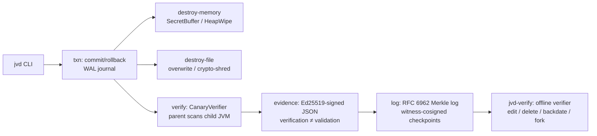

# jverifydestroy (jvd)

A Java 25 library + CLI where data destruction is followed by **measured verification**, the evidence is **tamper-evident and offline-checkable**, and a failed destruction **rolls back safely**.

> **Honest limit — read first.** User-space Java **cannot verify physical flash**. SSD flash-translation-layer remapping, bad-block pools and controller-held copies are unobservable from this code. Every result in this project is **logical-level only**: process memory, heap dumps, file bytes and filesystem images visible through OS/JVM interfaces. Every assurance level below carries *"physical media NOT verified"* unless the user attaches external evidence (e.g. a drive sanitize log).

## Why
Most erasure tools answer *what* was destroyed and *how*, weakly *whether it worked*, and partly *whether the evidence is honest*. Their verification is the tool grading its own homework. jvd's thesis (corrected per NIST SP 800-88 Rev.2 — see `docs/RESEARCH_AUDIT.md`): **automate verification strong enough that the validation decision is not a rubber stamp.** In Rev.2 terms, *verification* inspects the outcome of the sanitization operation; *validation* is the separate, risk-based **decision** that reviews verification results and accepts, rejects or escalates. This tool produces measured verification — including a measured **false-assurance rate** — and records the validation decision separately, by name, in the evidence.

## Architecture


## Modules
| Module | What it does | Claim → evidence |
|---|---|---|
| `destroy-memory` | `SecretBuffer`: off-heap (FFM), page-aligned, `fill(0)` before Arena close, best-effort `mlock` + `MADV_DONTDUMP` with a *reported* hardening status. `HeapWipe`: `Arrays.fill` for `byte[]`/`char[]`, **labelled best-effort**. | Tests: `SecretBufferTest` (4). Spikes: H2, H5 |
| `destroy-file` | Single-pass overwrite + fsync + delete (**Clear; weak on flash and COW filesystems**). Crypto-shred: per-file AES-256-GCM DEK wrapped by a KEK; shredding = destroying the wrapped DEK. | Tests: `FileDestroyTest` (4). Experiments: file trials |
| `txn` | Destruction transaction `STAGED → VAULTED → SCRUBBED → VALIDATED_PRECOMMIT → COMMITTED`, write-ahead journal (fsynced), crash recovery. Rollback only **before** COMMIT; the ABORTED event is appended/witnessed **before** any restore. **Restore after COMMIT is never promised and is refused.** | Tests: `TransactionTest` (5), incl. real `kill -9` (halt) at every state |
| `verify` | Canary validation: a parent process scans a child victim JVM's `/proc/<pid>/mem` (primary) — never itself (spike H4). Canary **family** (raw / UTF-16LE / UTF-16BE / hex variants). **Positive and negative controls on every run; a run with a failed control is INVALID.** Results: `FOUND / NOT_FOUND / NOT_CHECKABLE(reason)`. | Tests: `CanaryVerifierTest` (3), incl. sabotaged-control → INVALID. Spikes H1–H4 |
| `evidence` | `EvidenceRecord` JSON, Ed25519-signed. `verification` (machine results) and `validation` (decision, decider, rationale) are **separate fields**, mapped to NIST SP 800-88 Rev.2; Rev.2 Appendix C media fields are mapped to logical analogues and the mapping is stated in the record. | Tests: `EvidenceTest` (4) |
| `log` | Append-only Merkle log, **RFC 6962** hashing, C2SP-style signed checkpoints, **independent witness co-signature** (refuses if witness key = log key), inclusion + consistency proofs. | Tests: `MerkleLogTest` (6); consistency verified for all (m,n), n≤32 |
| `verifier-cli` | `jvd-verify`: fully offline. Detects edited records, deleted records, backdated/reordered timestamps, and forked logs (divergent checkpoints). | Tests: `VerifierCliTest` (6). Experiments: tamper trials |
| `cli` | `jvd`: `destroy-file`, `verify-memory`, `version`. Note: `destroy-file` runs no canary controls, so it honestly reports **A0** (see levels). | Tests: `CliSmokeTest` (2) |

## Assurance levels
- **A0** — deletion only; **or any run whose controls failed (INVALID)**; or a transaction still pre-COMMIT.
- **A1** — best-effort overwrite/heap wipe + canary `NOT_FOUND` in all checkable locations **with valid controls**.
- **A2** — crypto-shred COMMITTED + post-commit decrypt attempt fails + controls valid.
- **A3** — A2 + evidence in a witness-cosigned log + independent re-validation by a separate process.
- All levels: *physical media NOT verified* (see the honest limit above).

## Threat model
**Defends against:** a dishonest tool operator (signed, append-only, witness-cosigned evidence), backdated or deleted evidence (monotonic timestamps, Merkle proofs, witness-bound checkpoint times — limits in `docs/ASSUMPTIONS.md` #9), un-wiped secrets reported as destroyed (independent canary verification with controls), crashes mid-destruction (journal + rollback, never a false "destroyed").
**Does NOT defend against:** physical SSD remapping, pre-existing copies (backups, earlier swap), a compromised JVM/OS, a witness colluding with the operator, or an operator who never runs the verifier.

## What the measurements say (summary; full data in `docs/RESULTS.md`)
- Merely **dropping a reference** left dropped arrays intact in memory — in the Phase 2 spike, an un-wiped control left **300,001 copies** of a 48-byte canary findable. Unreachable ≠ erased.
- After a promotion GC, wiping the live `byte[]` still left **stale copies** measurable under G1 and ZGC (spike H2); the N=200 experiment matrix in `docs/RESULTS.md` gives per-collector false-assurance rates with Wilson 95% CIs.
- Unlinking a file on an ext4 image left **200/200** canary files' contents in the raw image; single-pass overwrite read back clean at the *logical* level in 200/200 (COW/physical copies NOT_CHECKABLE — H6).
- Heap dumps are a trap if used naively: a default `jcmd GC.heap_dump` GCs away unreachable evidence before dumping; `-all=true` preserves it, and a default dump taken first destroys it for later checks (spike H3).

## Build & run
Requires JDK 25 (FFM final; developed on Temurin 25.0.5) and Maven 3.9+.
```bash
mvn -q verify            # 34 tests, all green at time of writing
scripts/run_experiments.sh   # regenerates experiments/results/*.csv and docs/RESULTS.md
```
This sandbox's Java processes have no direct network; `scripts/prefetch_maven_deps.py` (see `docs/ASSUMPTIONS.md` #15) pre-fetches the JUnit closure via curl so Maven resolves locally. On a normal machine, plain `mvn` fetches directly. The library and CLIs themselves make **no network calls**.

## Docs
- `docs/RESEARCH_AUDIT.md` — Phase 1: every claim in the originating report, audited (13 CONFIRMED / 9 PARTLY / 4 UNVERIFIABLE / 0 wholly REFUTED, 2 sub-claims refuted).
- `docs/SPIKES.md` — Phase 2: H1–H6 settled by running code on JDK 25.
- `docs/PLAN.md` — Phase 3: scope, threat model, and 10 explicit deviations from the report (D1–D10).
- `docs/ASSUMPTIONS.md` — every autonomous decision, logged.
- `docs/RELATED_WORK.md` — honest prior art; novelty is the combination + measured results.
- `docs/RESULTS.md` — experiment results, generated only from real runs.
